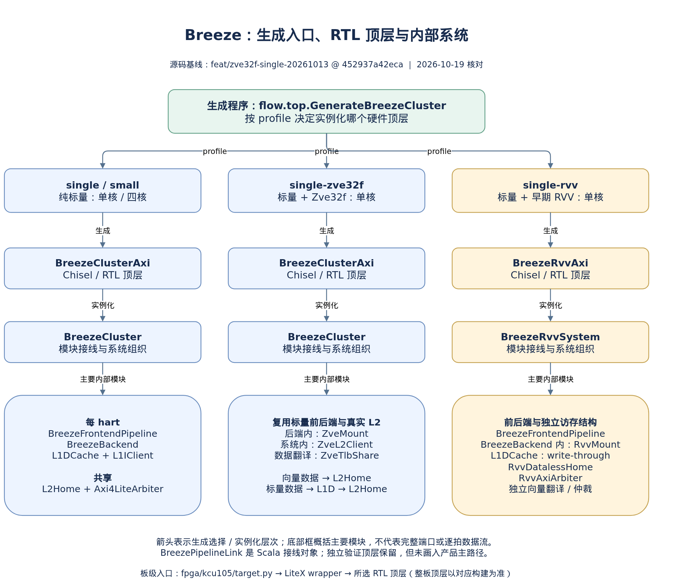

# Breeze 源码入口与第一轮清理

核对日期：2026-10-19。目标：同一套源码保留纯标量和 RVV 配置，明确生成入口、硬件顶层和模块边界，再逐批删除无引用实现。

## 1. 本次使用哪套源码

| 工作区 | 分支与 HEAD | 整核使用的前端 | 定位 |
| --- | --- | --- | --- |
| `/home/chen/leisure/flow` | `timing/soc3e-pipeline` / `2051dd0bb9a0c701bb95fd3f1e755ae175023093` | `BreezeFrontend` | 较早的标量整核；新前端另有独立顶层 |
| `/home/chen/leisure/flow-be2` | `refactor/be2-backend-decoupling` / `99c7e8d9adf324de3e1e35a990832029674e2c3e` | `BreezeFrontendPipeline` | BE2、新前端整核集成及早期 RVV 路径 |
| `/home/chen/leisure/flow/.worktrees/zve32f-single` | `feat/zve32f-single-20261013` / `452937a42ecae8f8592ebc3482feec93de31ca20` | `BreezeFrontendPipeline` | 本次清理基线，保留标量、早期 RVV 和 Zve32f 配置 |

已用 `git merge-base --is-ancestor` 核对：`2051dd0` 是 `99c7e8d` 的祖先，后者是 `452937a` 的祖先。主目录不等于最新实现。本次不切换主目录分支、不合并 worktree，也不删除其他工作区。

清理改动位于第三行工作区，是该 SHA 之上的未提交改动。该工作区原有未跟踪的 GEMV 测试、汇编及 Window 实验记录均保留。

## 2. 顶层与生成入口

统一生成入口是 [GenerateBreezeCluster.scala](../design/src/main/scala/top/GenerateBreezeCluster.scala) 中的 `flow.top.GenerateBreezeCluster`。

| profile | 用途 | 生成的 Chisel/RTL 顶层 | 内部系统连接模块 |
| --- | --- | --- | --- |
| `single` | 单核纯标量 | `BreezeClusterAxi` | `BreezeCluster` |
| `small` | 四核纯标量 | `BreezeClusterAxi` | `BreezeCluster` |
| `single-rvv` | 早期 RVV 单核路径 | `BreezeRvvAxi` | `BreezeRvvSystem` |
| `single-zve32f` | Zve32f 单核路径 | `BreezeClusterAxi` | `BreezeCluster`，启用 `ZveMount` / `ZveL2Client` |

profile 定义见 [config.scala](../design/src/main/scala/config/config.scala) 的 `BreezeClusterConfig` 和 `BreezeClusterPresets`。`single-rvv` 与 `single-zve32f` 是两条不同访存/执行路径；两者都保留，不能因为名称相近而合并或删除。profile 存在不等于完整 ISA、时序或上板已经验证。

下面是源码生成命令索引，执行目录为选定工作区的 `design/`。实际编译和生成前，仍须重新读取共享 [simulation-host.md](/home/chen/leisure/flow/docs/cross-project/simulation-host.md)，校验 cloud_chen，不可用再使用 Alan。

```sh
sbt 'runMain flow.top.GenerateBreezeCluster single gshare linux'
sbt 'runMain flow.top.GenerateBreezeCluster small gshare linux'
sbt 'runMain flow.top.GenerateBreezeCluster single-rvv gshare linux'
sbt 'runMain flow.top.GenerateBreezeCluster single-zve32f gshare linux'
```

可选参数为 `tandem`、`fpga-debug`、`coherent-dma`。`design/build.sbt` 的 `elaborate` 在本基线只生成 `single gshare linux`，不自动覆盖 RVV 产品。

入口关系图（箭头表示生成选择与实例化层次）：



[下载可编辑 Draw.io 文件](figures/breeze-entrypoints/breeze-entrypoints.drawio)。原生 XML 结构检查通过；预览用官方 Draw.io viewer 渲染并已目视检查。

## 3. 先从哪一层读代码

```text
生成程序：GenerateBreezeCluster（按 profile 选择硬件顶层）
  single / small / single-zve32f
    BreezeClusterAxi
      BreezeCluster
        共享：L2Home、Axi4LiteArbiter
        每 hart：BreezeFrontendPipeline、BreezeBackend、L1DCache、L1IClient
        Zve32f 配置：ZveL2Client、ZveTlbShare
      可选：CoherentDmaWishbone、BreezeHangMonitor
  single-rvv
    BreezeRvvAxi
      BreezeRvvSystem
        BreezeFrontendPipeline、BreezeBackend、L1DCache（write-through）
        L1IClient、RvvDatalessHome、RvvAxiArbiter
        RvvTranslationClient、RvvTlbArbiter、Axi4LiteArbiter
```

这个树只列主要实例化层次。`BreezePipelineLink` 是 Scala 接线辅助对象，不是一个额外硬件流水级：它连接前后端的指令、解析、提交和恢复信号。

纯标量与 Zve32f 复用 `BreezeCluster`：前端内部实例化 `Sv39Mmu`，其 dTLB/PTW 端口供系统连接 L1D；启用 Zve32f 时，通过 `ZveTlbShare` 共享数据翻译。后端内部按配置实例化 `ZveMount`。向量普通数据经 `ZveL2Client` 接真实 `L2Home`，不穿过标量 L1D。

早期 `single-rvv` 使用 `RvvMount`、写穿 L1D、`RvvDatalessHome` 和宽 AXI 路径。它不是 Zve32f 的 L2 连接方式。

建议分析顺序：`GenerateBreezeCluster` 的配置选择 → `BreezeClusterAxi` 的外部接口 → `BreezeCluster` 的模块接线 → `BreezeFrontendPipeline` → 后端 → L1D/MMU/L2 → 两条向量路径。每个模块再单独补内部结构和逐拍场景。

## 4. FPGA 层次

KCU105 板级入口是 [fpga/kcu105/target.py](../fpga/kcu105/target.py) 的 `BreezeKCU105SoC`，由 LiteX/Migen 组织 DDR、外设及 CPU wrapper。CPU wrapper 位于 [litex_wrapper/flow/core.py](../litex_wrapper/flow/core.py)，加载 `filelist.f`，校验 `cluster-profile.txt` 并实例化相应 RTL 顶层。

因此要区分三个概念：生成程序 `GenerateBreezeCluster`；CPU/集群硬件顶层 `BreezeClusterAxi` 或 `BreezeRvvAxi`；完整 FPGA 工程的板级顶层（KCU105 构建通常为 `xilinx_kcu105`，具体以该次工程为准）。

## 5. 第一轮已删除的文件

仅在本次基线工作区删除以下三个旧模块；未修改任何活动实例、配置、接口或测试期望。

| 文件 | 删除依据 |
| --- | --- |
| `design/src/main/scala/bus/DCacheWishboneBridge.scala` | 当前内存主路径使用 AXI；该类及其状态枚举无其他源码、测试或构建入口引用 |
| `design/src/main/scala/bus/BreezeMmioArbiter.scala` | 当前 MMIO 使用 `Axi4LiteArbiter`；旧脉冲协议仲裁器及状态枚举无其他活动引用 |
| `design/src/main/scala/mmu/BreezeDataTranslator.scala` | 当前使用 `Sv39Mmu` 的 dTLB/PTW 接口；本基线中旧翻译适配器无其他活动引用 |

检索覆盖当前 Git 跟踪文件及相关未跟踪代码，并包括 Makefile 和 Verilator 的 `V` 前缀模块名。上述名字仍可能出现在历史文档、归档记录和旧利用率报告中；这些资料不是当前实例化关系，保留原样。

删除前的三文件原文、SHA-256、原工作区状态、删除 diff 和编译输入快照保存在本机 `/home/chen/leisure/flow/records/breeze-cleanup-20261019/`。可用 `before/` 内原文件恢复。

## 6. 保留和后续候选

| 对象 | 本轮处理与原因 |
| --- | --- |
| `BreezeFrontendPipeline`、`BreezePipelinePredictor`、`BreezeViptICache`、`BreezeCompressedDecoder` | 保留，生产前端使用 |
| `rvv/` 与 `rvv/zve/` | 保留两套向量入口和共享依赖；不能整目录判废 |
| `BreezeFrontendL2System`、`BreezeFrontendTimingHarness` | 保留，独立集成/时序验证入口；不是完整 CPU 顶层 |
| `mmu/BreezeMmu.scala` | 保留，旧 MMU 仍被 `BreezeMmuSpec`、`BreezeMmuAdSpec`、`BreezePmpSharingSpec` 引用；退役需连同测试职责一起审查 |
| `core/`、`interface/`、`cache/` | 保留，目录名旧但仍包含活动后端、CSR、译码、PMP、AMO 等共享定义 |
| `fase/`、`wishbone/` | 保留，独立控制器、记录器或 UART/Wishbone 工程仍有引用 |
| `hello/` | 保留为下一轮成组退役候选，`sim/simple/Makefile`、`sim/simple/sim_hellomem.cpp`、`sim/datapath/` 仍引用例程 |
| Air、Wisp、matrix 及其 FPGA 工程 | 独立产品/实验，未进入本次 Breeze 清理范围 |
| `records/`、旧 `.bit`/`.ltx`/报告、其他 worktree | 保留，既有证据和工作区不因模块未进入当前配置而删除 |

主目录 `2051dd0` 中仍存在的旧前端文件，包括 `BreezeFrontend`、`BreezeBTB`、`BreezePHT`、`BreezeFetchTranslator`、`BreezeInstrRealigner`、`BreezeFrontendBoundary`，以及 `FetchBuffer`、`FetchTlbClient`、旧 `L1ICache`，在 `99c7e8d` 后的基线已经删除。不要在旧主目录再次照单删除：旧整核仍实例化它们。应在选定主线工作区继续整理。

## 7. 文档过期点与验证范围

主目录 `2051dd0` 的 `design/build.sbt` 指向不存在的 `GenerateBreezeCoreWishbone`；其 KCU105 README 使用不存在的 `GenerateBreezeMulticoreClusterWishbone`，根 README 也仍链接不存在的 `core/BreezeCore.scala`。这些是过期入口。当前任务用上述源代码索引替代它们；历史发布镜像的说明与验证结论不迁移到新源码。

本报告的层次和候选判定来自静态源码核对。共扫描 570 个代码与构建文件，已删除的三个类及两个状态枚举均无剩余引用。生成入口、两套系统顶层、后端、配置及 LiteX/KCU105 接线文件与基线逐字节一致。

第一轮验证于 Alan 执行：

- cloud_chen `47.96.71.231:22` SSH 连接超时（exit 255），按当次读取的共享配置回退到 Alan，`chen@localhost:2286` 经 `clawbot`。
- 独立 cwd：`/home/chen/FUN/flow-cleanup-20261019-90bd6f35/design`。
- 输入：`452937a` 工作区删除后的源码快照，包含原有未跟踪的 `FlowZveGemvSpec.scala`；源码归档 SHA-256 为 `90bd6f35406c04a27bb52c0debb49be7adb230cd57d5b3988e698b0a9d116671`。清理后的未提交状态不能只用基线 SHA 表示。
- 实际工具：Java `11.0.32.1`、项目指定 sbt `1.9.7`。Alan 原有 sbt wrapper 指向缺失文件，首次启动 exit 127；随后在本任务 evidence 目录下载 Maven launcher，经恢复的反向代理运行，不修改全局工具配置。
- 命令的 sbt 任务：`Compile / compile`、`Test / compile`、`testOnly flow.config.BreezeCoreConfigSpec`。完整 Java 命令与 launcher 散列见本地 evidence。
- 结果：138 个主源码文件编译通过；113 个测试源码文件编译通过；配置测试 9/9，通过、失败/取消/忽略/pending 均为 0；最终 exit 0。`ClusterIsaSpec.scala:59` 有一个外部引用类型检查警告。
- Alan evidence：`/home/chen/FUN/flow-runs/breeze-cleanup-20261019-90bd6f35/`；日志已取回本地 `records/breeze-cleanup-20261019/alan-logs.tgz`。

这些结果覆盖删除后的编译依赖和配置测试，不是四种产品的 RTL 功能回归。未执行 RTL 生成、Vivado、bitstream 生成或上板验证。全部改动保持未提交；既有工作区和实验文件保留。
